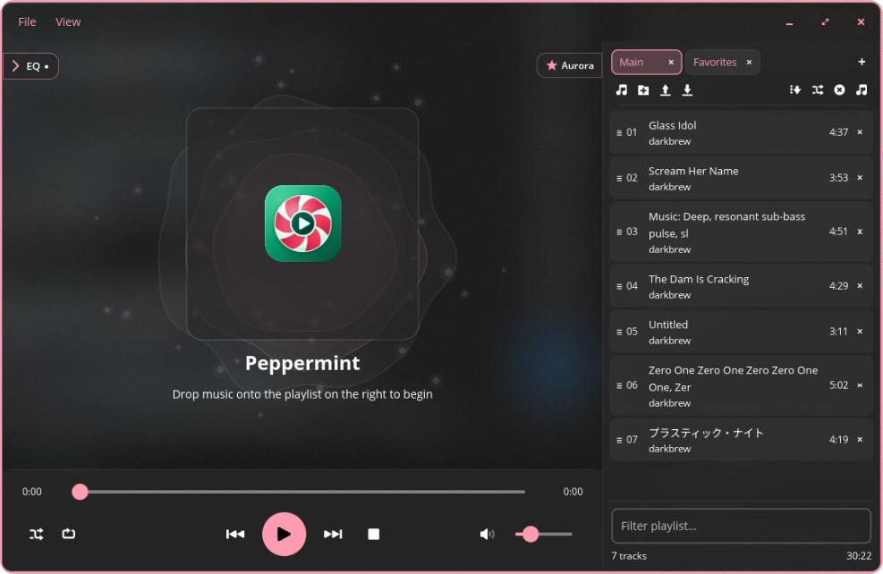

# Peppermint

A fast, native local music player for the **COSMIC Desktop**, built in Rust with `libcosmic`.



## Features

- **Gapless Playback & Crossfade:** Pre-decodes the upcoming track on the audio thread for seamless 0 ms transitions on live albums and continuous mixes, with optional equal-power crossfade, ReplayGain normalization, and soft pause/resume fading.
- **Settings Window (`Ctrl+,`):** Frosted pop-out Settings window with categorized tabs (**Audio & Playback**, **Appearance**, **Library & Playlists**, and **Lyrics & Shortcuts**) — tune gapless/crossfade, ReplayGain, frosted glass opacity, visualizer FPS, playlist density, duplicate handling, M3U path format, and lyrics display live.
- **Multi-Tab Resizable Playlists:** Always-visible playlist tab strip (`+` new tab, inline rename, close tab, `Ctrl+1..9` to switch tabs without interrupting playback), draggable sidebar splitter up to 50% of window width, and uniform single-line track cards that smoothly scroll long titles on hover.
- **Full Drag-and-Drop Control:** Drag tracks to reorder them with a COSMIC-accent drop indicator, nudge with `Alt+Up`/`Alt+Down`, or drag audio files and folders straight from **COSMIC Files** onto any playlist tab.
- **Track Info & Tag Editor:** Right-click any track (or press `Ctrl+I` / `Alt+3`) to open a frosted pop-out window showing audio file details and editing embedded Title, Artist, Album, Track #, Year, Genre, Album Art, and Lyrics directly in your music files.
- **Stylish Lyrics Viewer:** Open a dedicated frosted Lyrics pop-out window (`Ctrl+Y` or the left-edge **Lyrics** pull-tab under `> EQ`), or cycle the main stage directly into bold **Lyrics** mode via the top-right visualizer rotation (`V`). Supports synced `.lrc` timestamps (sidecar `.lrc` files or embedded tags) with live active-line highlighting and click-to-seek, plus plain-text lyrics fallback.
- **Semi-Transparent Background Visualizers:** Live post-EQ FFT visualizers floating behind the free-floating Album Art (**Aurora Orbit**, **Peppermint Kaleidoscope**, **Cosmic Nebula**, **Lyrics**, and **Off** — cycle with the top-right pill or `V`).
- **Real-Time 10-Band Equalizer:** Top-left `> EQ` slide-out bar with lock-free pure-Rust biquad peaking EQ (`60`, `170`, `310`, `600`, `1K`, `3K`, `6K`, `12K`, `14K`, `16K` Hz + Preamp), live frequency-response curve, Bypass toggle, and 10 built-in presets.
- **Collapsible Local Library:** Browse `~/Music` (or any folders) by **Tracks**, **Albums**, **Artists**, or **Folders**, filter instantly, and append tracks or entire albums to the active playlist tab.
- **M3U / M3U8 & Auto-Persistence:** Import/export `.m3u8` playlists and automatically preserve tabs, track order, EQ, volume, and library folders in `~/.local/share/peppermint/state.json`.
- **Format Support:** MP3, FLAC, OGG Vorbis, Opus, WAV, M4A, AAC, and AIFF via pure Rust (`rodio` + `symphonia` + `lofty`).

## Keyboard Shortcuts

| Shortcut | Action |
| --- | --- |
| `Space` | Play / Pause |
| `Enter` | Play selected track |
| `Delete` / `Backspace` | Remove selected track |
| `Up` / `Down` | Select previous / next track |
| `Alt+Up` / `Alt+Down` | Move selected track up / down |
| `Ctrl+T` | New playlist tab |
| `Ctrl+1` – `Ctrl+9` | Switch to playlist tab 1–9 |
| `Ctrl+E` | Toggle 10-Band Equalizer |
| `Ctrl+L` | Toggle Local Library sidebar |
| `Ctrl+I` / `Alt+3` | Open Track Info & Tag Editor |
| `Ctrl+Y` | Open Lyrics Viewer window |
| `Ctrl+,` | Open Settings window |
| `V` | Cycle background visualizer style |

## Running

```bash
cargo run
```

For an optimized release build:

```bash
cargo run --release
```

## Flatpak & COSMIC Store

### 1. Build & Install Locally as a Flatpak

Install `flatpak-builder` and the Freedesktop 26.08 SDK + Rust extension once:

```bash
sudo dnf install flatpak-builder
flatpak install flathub \
  org.freedesktop.Platform//26.08 \
  org.freedesktop.Sdk//26.08 \
  org.freedesktop.Sdk.Extension.rust-stable//26.08
```

Then build, install for your user, and export a shareable `flatpak/peppermint.flatpak` bundle:

```bash
./flatpak/build-local.sh
flatpak run io.github.tealeafshark.Peppermint
```

### 2. Publishing to Flathub & COSMIC Store

COSMIC Store automatically discovers and highlights native COSMIC apps from Flathub that include `<provides><id>com.system76.CosmicApplication</id></provides>` (already configured in `resources/app.metainfo.xml`).

1. Tag a release on GitHub (`v0.1.0`) and add the commit SHA to `flatpak/io.github.tealeafshark.Peppermint.yml`.
2. Generate `flatpak/cargo-sources.json` using `flatpak-cargo-generator.py`.
3. Open a Pull Request to `flathub/flathub` targeting the `new-pr` branch with `io.github.tealeafshark.Peppermint.yml` and `cargo-sources.json`.
